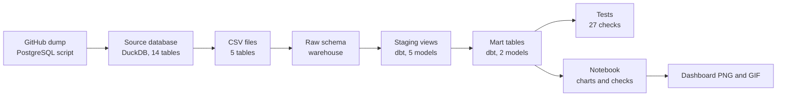
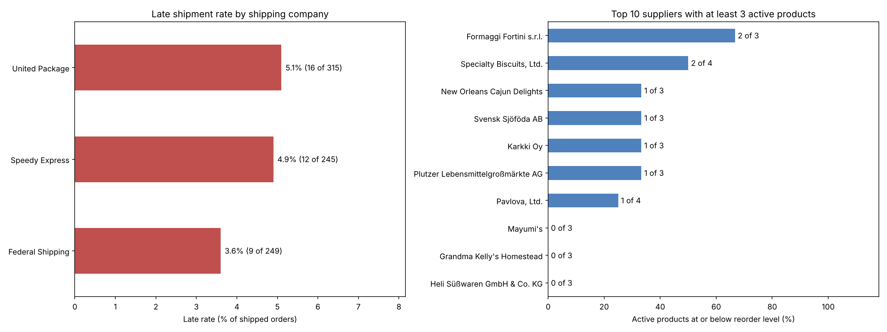
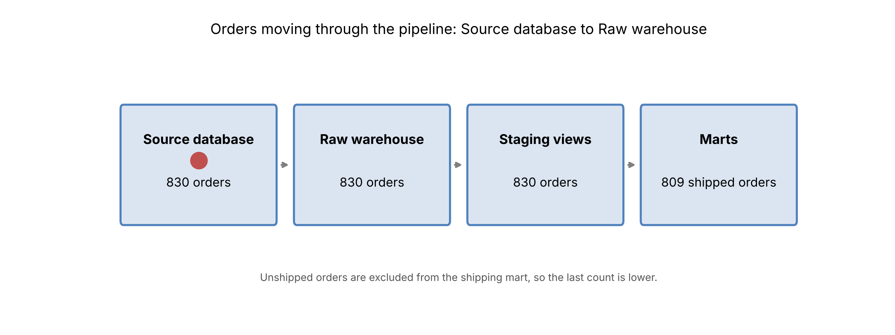

# Supply Chain Data Pipeline (Northwind)

An end-to-end data pipeline that answers two supply chain questions: are carriers delivering on time, and which suppliers put us at risk of running out of stock. It takes raw operational data, loads it into a warehouse, transforms it with dbt, tests it, and produces tables, charts, and an animation.

The data comes from **Northwind**, a sample database for a fictional food importer. The business questions are real ones, but the answers describe this dataset, not a real company.

## The business problem

A supply chain team needs answers to two questions every week:

1. **Are our carriers delivering on time?** Late shipments lead to unhappy customers, refunds, and lost repeat orders. A manager needs to know which shipping company is causing delays.
2. **Which suppliers put us at risk of running out of stock?** When a product drops to its reorder level and the supplier is slow to restock, sales stop. A buyer needs to know which products and suppliers to act on first.

The raw data is spread across operational tables (orders, products, suppliers, shippers). Nobody can answer these questions by reading those tables directly, so the pipeline turns them into two clean, tested summary tables.

## Results

| Question | Finding |
|---|---|
| **Carrier on-time performance** | Late rates are 5.1% (United Package, 16 of 315 shipped orders), 4.9% (Speedy Express, 12 of 245), and 3.6% (Federal Shipping, 9 of 249). Late shipments happen across all carriers, and the gap is too small to rank them. |
| **Inventory risk** | 17 active products are at or below their reorder level. 16 of them already have stock on order. |
| **Action items** | Nord-Ost Matjeshering has no stock on order and needs one. Outback Lager's order (10 units) doesn't cover its shortfall (15 units). Formaggi Fortini (2 of 3 products low) and Specialty Biscuits (2 of 4) need a supplier review. |

**Limits:** the data covers 1996 to 1998, has no delivery or receipt dates, and holds one snapshot of stock levels. It can show where things stand, not why they happened or where they're heading. 21 orders haven't shipped yet and are excluded from the shipping metrics.

## Architecture



## What the pipeline does, step by step

1. **Extract.** The notebook downloads the Northwind SQL dump, loads it into a source database, and exports five tables to CSV. This stands in for pulling data out of an operational system.
2. **Load.** The CSVs are copied into the warehouse's `raw` schema without changes, so the original data is always available.
3. **Stage (dbt).** Five staging views rename columns and cast types. Nothing is aggregated here.
4. **Mart (dbt).** Two tables answer the business questions:
   - `mart_shipping_performance`: shipped orders, late orders, late rate, and average days to ship, per carrier.
   - `mart_supplier_inventory_risk`: active products, products at or below reorder level, and units in stock and on order, per supplier.
5. **Test (dbt).** 27 checks run on every build: unique and non-empty keys, valid foreign keys, and no order can ship before it was placed. If a check fails, the build stops.
6. **Reconcile and report.** The notebook recalculates the totals from raw data and checks that the marts match. It then saves the dashboard and an animation of an order moving through the pipeline.

## Tools and why they were chosen

| Tool | Role | Why |
|---|---|---|
| **Python** (`urllib`, `pandas`, `matplotlib`) | Downloads the source, loads files, draws charts | Standard tools for data work and reporting |
| **DuckDB** | Stores the source database, warehouse, and marts in one local file | Fast SQL analytics with no server to run |
| **SQL** | Used by every dbt model and the notebook queries | The common language of data teams |
| **dbt** (dbt-core and dbt-duckdb) | Builds the layered models, runs the tests, and tracks dependencies | Turns SQL into versioned, tested models |
| **Jupyter notebook** | One entry point that runs every step and shows the results | Anyone can rerun the whole pipeline and see each output |

## Outputs

**Dashboard**



**Pipeline animation**



**Warehouse tables**

| Object | Type | Rows |
|---|---|---|
| `raw.orders` | table | 830 |
| `raw.order_details` | table | 2,155 |
| `raw.products` | table | 77 |
| `raw.suppliers` | table | 29 |
| `raw.shippers` | table | 6 |
| `main.stg_*` (5 views) | view | same as raw |
| `main.mart_shipping_performance` | table | 3 |
| `main.mart_supplier_inventory_risk` | table | 28 |

## Project structure

```
supply-chain-pipeline/
├── supply_chain_pipeline.ipynb     # the notebook; runs every step
├── README.md
├── data/
│   ├── source/                     # Northwind SQL dump, license, source database
│   └── raw/                        # CSV exports of the five tables used
├── dbt_project/
│   ├── dbt_project.yml             # project settings
│   ├── profiles.yml                # database connection
│   ├── models/
│   │   ├── staging/                # 5 staging views and their tests
│   │   └── marts/                  # 2 mart tables and their tests
│   └── tests/                      # singular test: no order ships before it's placed
├── warehouse/
│   └── supply_chain.duckdb         # the warehouse, built by the notebook
└── reports/
    ├── supply_chain_dashboard.png  # charts
    └── pipeline_flow.gif           # animation for stakeholders
```

## How to run

Requirements: Python 3.10 or newer. The notebook installs its own packages.

1. Open `supply_chain_pipeline.ipynb` (locally or in Google Colab).
2. Run all cells from the top.

The notebook downloads the source data, writes the dbt project files, builds the warehouse, runs the 27 tests, and saves the charts and animation. To run dbt by itself from `dbt_project/`:

```
dbt build --profiles-dir .
```

## Next steps

- Add a scheduler so the pipeline runs on a timer, not only by hand.
- Load new data in batches, so each run only processes new records (incremental loading).
- Add supplier delivery dates, so supplier performance can be measured, not just stock position.
- Add dbt documentation and a lineage diagram.

## Data source and license

Northwind is a sample database originally published by Microsoft under the Microsoft Public License (Ms-PL). The license is included in `data/source/LICENSE`.
